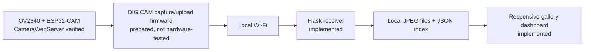

# DIGICAM

**A local-first, low-cost digital camera for community environmental documentation.**

DIGICAM is an early-stage prototype built around an AI Thinker ESP32-CAM and OV2640 camera. The project explores a simple way to capture photographs over Wi-Fi and keep them in a local, browsable library on a laptop. No cloud storage or microSD card is required by the current design.

> **Project status:** The camera hardware and original CameraWebServer are verified. The Flask receiver and dashboard are implemented. The modified camera upload firmware is prepared but has not yet been compiled, flashed, or tested end to end on the camera. The physical shutter button and environmental sensors are planned work.

## Problem statement

Local environmental observations are easier to discuss when people can record and review them. DIGICAM explores an affordable, repairable camera and a private local photo library that can support this kind of documentation without requiring a cloud account. The prototype is still being developed; it has not yet been used to collect or evaluate community environmental data.

## Objectives

- Build a low-cost Wi-Fi camera using the ESP32-CAM and OV2640.
- Receive photographs on a nearby laptop and store them locally.
- Provide a simple gallery with capture time and image details.
- Add a physical shutter after validating a safe GPIO for the exact board setup.
- Explore future environmental monitoring and community documentation workflows.
- Keep the system understandable, local-first, and usable without paid services.

## SDG relevance

- **SDG 11 — Sustainable Cities and Communities:** The project aims to make local photographic documentation more accessible for community discussion about places and environmental conditions.
- **SDG 12 — Responsible Consumption and Production:** The project uses low-cost, widely available hardware and local storage, and is designed to avoid unnecessary cloud services and consumables such as a camera microSD card.

These are areas of intended alignment, not measured project outcomes or an endorsement by the United Nations.

## Hardware

| Component | Status | Notes |
| --- | --- | --- |
| AI Thinker ESP32-CAM | Verified | Existing board; CameraWebServer uploads and runs. |
| OV2640 camera module | Verified | Live camera feed is visible. |
| ESP32-CAM-MB USB programmer | Verified | Used to program the camera board. |
| Windows laptop | Verified | Intended to run the receiver and gallery locally. |
| Wi-Fi network | Verified | Camera has joined the local network. |
| Physical shutter button | Planned | GPIO and wiring are not selected yet. |
| Environmental sensor(s) | Future consideration | No sensor has been selected or implemented. |

No microSD card is used. The live stream currently has a low frame rate; optimization is deferred until the capture and upload workflow is working.

See [hardware notes](docs/hardware.md) for the current pin map and safe integration status.

## System architecture



The intended upload is a raw JPEG HTTP POST to the laptop. The Flask receiver validates the JPEG, saves it under a year/month folder, and records metadata in a JSON index. The dashboard reads that index and displays local image previews.

## Software stack

- **Camera firmware:** Arduino IDE, Espressif Arduino-ESP32 core, ESP32 camera driver, and the existing CameraWebServer example.
- **Laptop receiver:** Python, Flask, and Pillow for JPEG validation and image dimensions.
- **Dashboard:** HTML, CSS, and vanilla JavaScript served by Flask.
- **Storage:** Local JPEG files and a JSON metadata index; no database or cloud service.

## Repository layout

```text
DIGICAM/
├── backend/
│   ├── app.py                 # Flask API, local storage, and dashboard routes
│   ├── requirements.txt       # Python dependencies
│   ├── templates/index.html   # Dashboard markup
│   └── static/                # Dashboard CSS and JavaScript
├── docs/
│   └── hardware.md            # Verified hardware and pin notes
├── firmware/
│   └── esp32cam/
│       ├── DIGICAM_CameraWebServer.ino
│       ├── digicam_config.example.h
│       └── README.md
├── .gitignore
└── README.md
```

Images and `index.json` are created locally under `backend/captures/` when the receiver runs. That directory is ignored by Git.

## Run the laptop app

From the repository root in PowerShell:

```powershell
python -m venv .venv
.\.venv\Scripts\python.exe -m pip install -r backend\requirements.txt
.\.venv\Scripts\python.exe backend\app.py
```

Open <http://127.0.0.1:5000> on the laptop. The receiver listens on the local network for the ESP32-CAM. If Windows Firewall asks, allow Python on the private/home network. The laptop and camera need to be on the same local network.

The gallery supports browser JPEG uploads for trying the dashboard before camera uploads are connected. The backend accepts raw `image/jpeg` POST requests at `/api/captures`; `/api/health` reports receiver status.

## Firmware setup

The firmware file is a replacement main sketch intended to be used inside a copy of the installed Arduino `CameraWebServer` example. The example's `app_httpd.cpp`, `board_config.h`, `camera_pins.h`, and `camera_index.h` remain provided by the installed ESP32 Arduino package rather than being duplicated here.

Follow [firmware/esp32cam/README.md](firmware/esp32cam/README.md) to copy the example, create a local `digicam_config.h`, set the laptop's Wi-Fi IP, compile, and upload. The test shutter command is `c` in Serial Monitor. Do not connect a physical button until a safe pin has been selected for the exact board and setup.

## Current implementation status

### Verified on the hardware

- AI Thinker ESP32-CAM with OV2640 initializes and streams using the existing CameraWebServer firmware.
- The camera joins Wi-Fi and its local camera page opens in a browser.
- Arduino IDE and the ESP32 board package are configured.

### Implemented in the repository, awaiting full device validation

- Flask receiver accepts JPEG uploads, validates image data, stores files locally, and records timestamp, dimensions, and file size.
- Responsive dashboard displays the gallery, supports search and sorting, preview, download, delete, and browser JPEG uploads.
- A modified CameraWebServer main sketch is prepared to capture on a Serial Monitor command and POST JPEG data to the laptop.

### Not yet verified or implemented

- ESP32-CAM to laptop HTTP upload has not yet been tested end to end.
- The modified firmware has not yet been compiled and flashed on the board.
- Physical shutter button and GPIO selection are not implemented.
- Environmental sensors, automatic environmental readings, and community data workflows are not implemented.
- Streaming frame-rate optimization remains future work.

## Roadmap

1. Run the Flask receiver and confirm a browser JPEG appears in the local gallery.
2. Compile and flash the modified firmware in a copy of the working CameraWebServer sketch.
3. Verify a camera capture reaches the laptop and appears in the gallery.
4. Review the exact ESP32-CAM pin use and integrate a physical shutter button safely.
5. Improve capture metadata and reliability, including reconnect behavior.
6. Optimize live-stream performance after still-image capture is reliable.
7. Select suitable environmental sensors and define a responsible, useful community documentation workflow.

## Privacy and repository hygiene

- Keep Wi-Fi credentials in a local `digicam_config.h`; it is ignored by Git.
- Never commit passwords, API keys, private data, or local environment files.
- Camera captures and generated metadata are stored locally and ignored by Git.
- No cloud storage or paid service is required by the current prototype.
